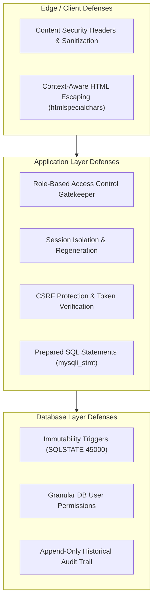

# SECURITY GUIDE — TCET SPECIALIZATION TRACKER
**Application:** TCET Specialization Tracker (TCET_ST)  
**Classification:** Academic Enterprise System  
**Version:** 3.2.0 Production Release  

---

## 1. Security Architecture & Threat Model

The TCET Specialization Tracker implements defense-in-depth across the application, database, and network layers to protect sensitive student records, examination histories, and institutional decisions.

---

## 2. Key Security Mitigations

### 2.1 Role-Based Access Control (RBAC)
- All endpoints verify session validity (`$_SESSION['user_id']`) and user role before executing queries.
- **Role Hierarchy:**
  - `Admin` / `SuperAdmin`: Unrestricted administrative actions and restricted audit logs.
  - `Faculty Coordinator`: Department-level directory access and CSV exports.
  - `Mentor`: Read-only access to mentored students.
  - `Student`: Access restricted to own personal record.

### 2.2 SQL Injection Prevention
- All user-supplied parameters received via `GET`, `POST`, or DataTables AJAX requests are parameterized using prepared statements (`$stmt = $conn->prepare(...)`).
- Raw string interpolation into SQL queries is strictly prohibited across the codebase.

### 2.3 Cross-Site Scripting (XSS) Prevention
- All dynamic data rendered in HTML templates and DataTables columns is escaped using `htmlspecialchars($data, ENT_QUOTES, 'UTF-8')`.
- Modals sanitize legacy free-text remarks before DOM insertion.

### 2.4 Internal Audit Information Isolation
- The candidate modal defaults to a client-facing view that omits internal engineering IDs, test markers, and automated sign-offs.
- The restricted audit interface is only rendered when `section=restricted_audit` is explicitly requested by an authenticated `Admin` session. Standard users and unauthorized requests receive an HTTP 403 Forbidden response.

### 2.5 Database-Level Immutability Enforcement
- The table `st_historical_candidate_audit` is protected by database triggers:
  - `trg_hist_audit_no_update`: Blocks any `UPDATE` command.
  - `trg_hist_audit_no_delete`: Blocks any `DELETE` command.
- These triggers operate independently of application code, ensuring protection even if an administrator accesses the database directly via SQL CLI or phpMyAdmin.
