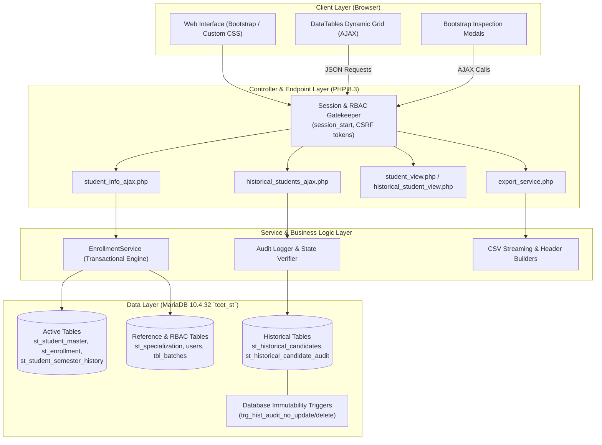

# SYSTEM ARCHITECTURE — TCET SPECIALIZATION TRACKER
**Document:** System Architecture Specification  
**Application:** TCET Specialization Tracker (TCET_ST)  
**Database:** `tcet_st` (MariaDB 10.4.32)  
**Version:** 3.2.0 Production Release  

---

## 1. Architectural Overview

The TCET Specialization Tracker is structured following a modular, layered Model-View-Controller (MVC) architecture optimized for performance, maintainability, and role-based data isolation.

---

## 2. Key Subsystems & Request Lifecycles

### 2.1 Enrolled Students AJAX Pipeline
1. **Request:** Browser initializes DataTables in `admin/student-info.php` and issues an asynchronous `POST` to `admin/student_info_ajax.php`.
2. **Authentication & Authorization:** Checks `$_SESSION['user_id']` and role permissions (`Admin`, `Faculty Coordinator`, `Mentor`).
3. **Query Optimization:**
   - Performs inner joins across `st_student_master`, `st_enrollment`, and `st_specialization`.
   - Dynamic server-side pagination (`LIMIT`, `OFFSET`), column-specific multi-sort, and sanitized SQL search filtering.
4. **Response:** Formatted JSON payload containing `recordsTotal`, `recordsFiltered`, and sanitised HTML rows for responsive display.

### 2.2 Historical Candidate Inspection & Audit Isolation
1. **Separation of Concerns:** The active student directory and historical candidates archive operate on separate tables (`st_student_master` vs `st_historical_candidates`).
2. **Client-Facing Presentation Layer:**
   - In standard client view (`historical_student_view.php?candidate_id=X`), the modal shows curated academic tracks, source enrollment data, and high-level reconciliation status.
   - Internal technical audit logs, test suite markers, and engineering IDs are completely omitted from the DOM.
3. **Restricted Engineering Audit Layer:**
   - Accessible only via explicit query parameter `&section=restricted_audit`.
   - Protected by strict session role checks (`Administrator` / `SuperAdmin`).
   - Renders complete chronological audit trail from `st_historical_candidate_audit`.

### 2.3 Data Integrity & Concurrency Control
- **Transactional State Changes:** All candidate state transitions execute inside MariaDB transactions (`START TRANSACTION ... COMMIT / ROLLBACK`) with row-level locks (`SELECT ... FOR UPDATE`).
- **Database-Level Defense:**
  - `trg_hist_audit_no_update`: Blocks any `UPDATE` operation on `st_historical_candidate_audit`.
  - `trg_hist_audit_no_delete`: Blocks any `DELETE` operation on `st_historical_candidate_audit`.

---

## 3. Technology Stack & Environmental Specifications

| Tier | Component | Technology / Version | Configuration |
|---|---|---|---|
| **Web Server** | Apache HTTP Server | Apache 2.4.58 (Win64) | VirtualHost / Directory rewrite enabled |
| **Runtime** | PHP | PHP 8.3.x / 8.2.x | `memory_limit=512M`, `display_errors=Off` (Prod) |
| **Database** | MariaDB | MariaDB 10.4.32 | `innodb_buffer_pool_size=1G`, `utf8mb4_unicode_ci` |
| **Client UI** | Dynamic Frontend | HTML5, CSS3, ES6 | jQuery 3.6+, DataTables 1.10+, Bootstrap 4/5 |
| **Testing** | Automated QA | PHP CLI, Puppeteer | Headless Chromium, PHPUnit compatibility |
